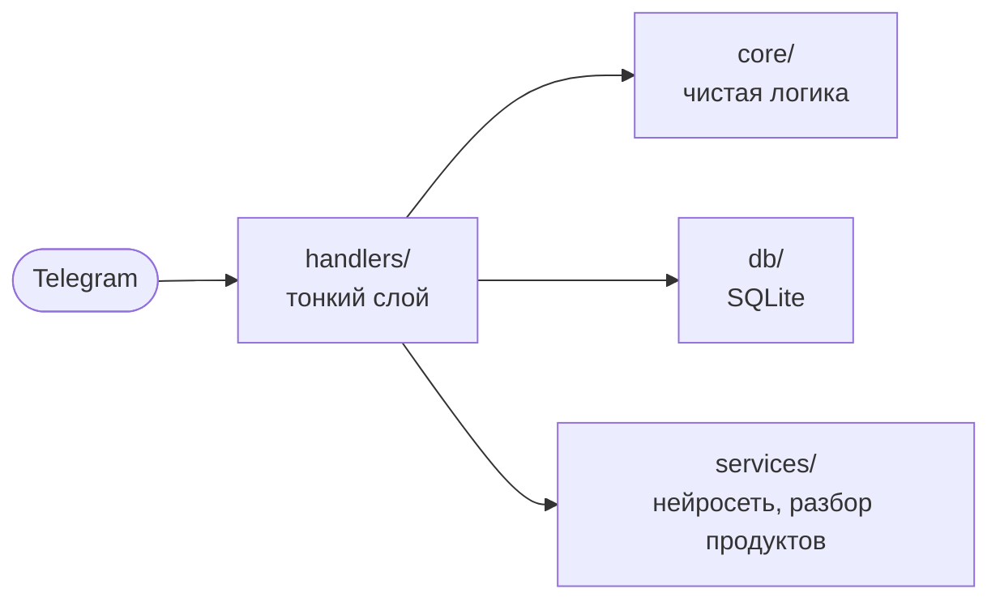

# Foxella 🦊 (Фоксела)

Telegram-бот «Питание без весов». Фоксела считает вашу норму калорий и составляет меню в «половниках», «грудках» и «ложках», так что взвешивать еду не нужно. Если день прошёл не по плану, она мягко подправит ближайшие дни, без упрёков и голодания.

[](https://github.com/SergeiCherk/foxella/actions/workflows/ci.yml)
[](https://www.python.org/)
[](LICENSE)

## Возможности

- **Расчёт нормы.** Пол, возраст, рост, вес, активность и цель: бот считает калории и БЖУ по формуле Миффлина-Сан Жеора. Для похудения и набора можно проверить, за какой срок цель достижима безопасно.
- **Меню на 1–3 дня без весов.** Порции в бытовых мерах: «2 половника гречки», «1 грудка», «1 чайная ложка масла».
- **Продукты обычным текстом.** «Курица, гречка, 2 яйца, помидоры»: бот понимает формы слов, опечатки и простые количества, а если слово неоднозначно («курица»), уточняет.
- **«Съел(а)» обычными словами.** «Тарелка борща со сметаной, 2 куска пиццы, бутылка пива»: в базе 70 готовых блюд и напитков, от пельменей до шаурмы, а незнакомое блюдо («лагман») нейросеть раскладывает на продукты, и калории считает код.
- **Список покупок.** Готовое пересчитывается обратно в то, что покупают («варёный рис» → «сухой рис»), то, что уже есть дома, отмечается.
- **Мягкий пересчёт после «срыва».** Превышение растягивается на ближайшие дни, не больше 10 % нормы в день и никогда не ниже безопасной границы калорий.
- **Подсказки по балансу.** Чего не хватает: белка, овощей и фруктов, клетчатки.
- **Ограничения в еде.** Без мяса, рыбы, молочного, яиц, орехов или глютена: такие продукты не попадут в меню ни от нейросети, ни из встроенных блюд.
- **Работает и без нейросети.** Без ключа бот использует встроенные рецепты.

Главная фишка: **без весов**. Бот сам знает, сколько граммов в вашем «половнике».

## Как это выглядит

Диалоги ниже получены запуском настоящего бота (см. [examples/](examples/)).

```text
Вы:   /start  →  Женщина → 32 → 168 → 64,5 → «Лёгкая активность» → «Похудеть»

Бот:  🎉 Готово! Твоя норма на день

      🔥 1606 ккал
      🥩 Белки: 116 г
      🥑 Жиры: 50 г
      🍚 Углеводы: 173 г
```

```text
Бот:  🍲 Обед · ≈ 540 ккал
      Б 55 · Ж 12 · У 54

      Курица с гречкой и огурцом
      🍗 Куриная грудка (готовая) — 1 грудка
      🌾 Гречка (варёная) — 2 половника
      🥬 Огурец — 1 огурец
      🫒 Масло подсолнечное — 1 чайная ложка

      ▾ 👩‍🍳 Как приготовить (раскрывается по нажатию)
```

```text
Вы:   /slip  →  «🍱 Много (как большой обед)»

Бот:  Всё в порядке, такое бывает 💛

      Сегодня вышло примерно на 900 ккал больше плана. Чтобы не урезать рацион,
      немного скорректируем только ближайшие дни (около 161 ккал в день),
      а остальное просто оставим как есть.
```

> Скриншоты и GIF добавьте в `docs/` и сошлитесь на них здесь, когда запустите бота у себя.

## Как это устроено



Подробнее: [docs/architecture.md](docs/architecture.md). Три ключевых решения (полный список: [docs/decisions.md](docs/decisions.md)):

1. **Калории считает код, а не нейросеть.** Нейросеть предлагает только блюда и тексты рецептов, а все числа считает программа по базе продуктов. Ответ нейросети всегда проверяется, а при сбое бот берёт встроенное блюдо.
2. **Бытовые меры, сырое и готовое отдельно.** «200 г риса» может быть 730 ккал (сухой) или 260 ккал (варёный). Поэтому «сухой» и «варёный» это разные продукты, и у каждой меры свой вес.
3. **Безопасный пересчёт после срыва.** Растягивается на 3 дня, не больше 10 % нормы в день, никогда не ниже нижней границы калорий. Съели меньше плана: ничего «добирать» не нужно. Тон ответов проверяется тестом: никаких упрёков.

## Установка

Нужны [git](https://git-scm.com/) и [uv](https://docs.astral.sh/uv/) (он сам скачает нужный Python 3.12).

Установка uv (если ещё нет):

```bash
# macOS / Linux
curl -LsSf https://astral.sh/uv/install.sh | sh
```

```powershell
# Windows (PowerShell)
powershell -ExecutionPolicy ByPass -c "irm https://astral.sh/uv/install.ps1 | iex"
```

Проект (Git Bash, macOS, Linux):

```bash
git clone https://github.com/SergeiCherk/foxella.git
cd foxella
uv sync
cp .env.example .env
```

В обычной командной строке Windows вместо `cp` используйте `copy .env.example .env`.

**Токен бота.** В Telegram откройте [@BotFather](https://t.me/BotFather), отправьте `/newbot`, выберите имя (например, `Foxella`) и получите токен вида `123456:ABC...`. Впишите его в `.env`:

```text
BOT_TOKEN=123456:ABC...
```

**Оформление бота** (по желанию, в том же @BotFather; команды в меню бот ставит сам):

| Команда | Что вставить |
|---|---|
| `/setdescription` (до 512 символов) | `🦊 Foxella — твой помощник в питании без кухонных весов.` и дальше: `Рассчитает норму калорий и БЖУ, составит меню из продуктов, которые есть дома, покажет порции в половниках и ложках и соберёт список покупок.` и `💚 Без строгих запретов и чувства вины.` |
| `/setabouttext` (до 120 символов) | `🦊 Меню, порции без весов и список покупок. Без запретов и чувства вины.` |
| `/setuserpic` | картинка с лисой |

## Быстрый старт

```bash
uv run python -m nutrition_bot
```

При запуске бот сам применяет миграции и заполняет базу продуктов. Откройте своего бота в Telegram и отправьте `/start`. Остановить: `Ctrl+C`.

Без ключа нейросети бот работает на встроенных рецептах. Чтобы подключить нейросеть, см. раздел «Настройка».

**Docker.** Пошаговый запуск на сервере, обновление и резервные копии: [docs/deploy.md](docs/deploy.md). Коротко:

```bash
cp .env.example .env        # впишите BOT_TOKEN
docker compose up -d --build
docker compose logs -f bot  # смотреть журнал
docker compose down         # остановить (данные сохраняются в томе bot_data)
```

## Настройка

Все переменные задаются в файле `.env` (образец: `.env.example`).

| Переменная | Значение по умолчанию | Назначение |
|---|---|---|
| `BOT_TOKEN` | нет (обязательна) | токен от @BotFather |
| `LLM_API_KEY` | пусто | ключ нейросети; без него бот работает на встроенных рецептах |
| `LLM_BASE_URL` | пусто | адрес OpenAI-совместимого API вашего провайдера |
| `LLM_MODEL` | `qwen3.8-flash` | имя модели; у разных провайдеров оно разное |
| `LLM_EXTRA_BODY` | `{}` | особые параметры запроса в JSON, например `{"enable_thinking": false}` |
| `LLM_MAX_TOKENS` | `8000` | предел длины ответа (токены «размышлений» входят в него) |
| `LLM_TIMEOUT_S` | `90` | таймаут одного вызова нейросети, секунды |
| `DATABASE_URL` | `sqlite+aiosqlite:///./nutrition_bot.db` | база данных |
| `LOG_LEVEL` | `INFO` | уровень журнала |

Нейросеть включается, когда заданы и `LLM_API_KEY`, и `LLM_BASE_URL`. Примеры адресов и имён моделей разных провайдеров есть в `.env.example`. Проверить подключение одной командой:

```bash
uv run python scripts/try_llm.py lunch 600
```

Скрипт покажет «сырой» ответ модели, вердикт проверки и итоговое меню. Пороги расчётов (дефицит, лимиты коррекции, паузы) лежат в `src/nutrition_bot/config.py`, их список с пояснениями: [docs/decisions.md](docs/decisions.md).

## Примеры использования

Ежедневные действия вынесены на панель кнопок под полем ввода: «🍽 Меню», «🛒 Покупки», «🔄 Не по плану», «👤 Профиль». Те же действия доступны командами. Команды бота: `/start` (знакомство и норма), `/menu` (меню на 1–3 дня), `/shopping` (список покупок), `/slip` (съел другое), `/profile` (мои данные), `/delete_me` (удалить всё).

Полные диалоги в [examples/](examples/).

## Частые проблемы

**«BOT_TOKEN is not set».** Файл `.env` не создан или токен не вписан. Выполните `cp .env.example .env` и впишите токен.

**Бот не отвечает.** Проверьте токен и что бот запущен. Если в журнале ошибка «Conflict: terminated by other getUpdates request», значит запущено два экземпляра с одним токеном: остановите лишний.

**В меню одни и те же блюда или «из готовых вариантов».** Нейросеть не подключена (не заданы `LLM_API_KEY` и `LLM_BASE_URL`) или отвечает с ошибками. Проверьте `uv run python scripts/try_llm.py` и журнал.

**Нейросеть отвечает, но меню всё равно встроенное.** Ответ не прошёл проверку (в журнале строки «LLM answer rejected»). Часто помогает отключить «мышление» модели через `LLM_EXTRA_BODY`, формат зависит от провайдера.

**В меню есть продукты, которых нет в моём списке.** Это ожидаемо: встроенные блюда не знают, что у вас есть дома масло или хлеб. Эти продукты попадут в список покупок.

**«Подожди немного» после нажатия «Составить меню».** Защита от повторных запросов: одно меню за раз и пауза 30 секунд.

**Сбросить локальную базу.** Остановите бота и удалите файл `nutrition_bot.db`. В Docker: `docker compose down -v`.

**`uv` не найден после установки.** Откройте новое окно терминала.

**Сомневаюсь в точности калорий.** 285 из 381 продукта взяты из USDA FoodData Central или рассчитаны из неё, 40 домашних блюд посчитаны по рецепту из этих продуктов, 56 российских продуктов (творог, кефир, ряженка, сырки и др.) взяты с карточек товаров ВкусВилла, как на упаковке. Подробности в [docs/data-sources.md](docs/data-sources.md).

## Для разработчиков

```bash
uv run pytest                                    # все тесты с покрытием (порог 80 %)
uv run pytest tests/unit/core/test_norms.py --no-cov   # тесты одного модуля
uv run ruff check . && uv run ruff format --check .
uv run mypy src/
uv run pre-commit install                        # проверки перед каждым коммитом
```

Работа с базой и данными:

```bash
uv run alembic upgrade head                      # применить миграции (бот делает это сам при старте)
uv run alembic revision --autogenerate -m "описание"   # новая миграция
uv run python scripts/validate_data.py           # проверка CSV с продуктами
uv run python scripts/import_usda.py             # сверка с USDA (--write обновит foods.csv)
uv run python scripts/seed_db.py                 # заполнить базу вручную
uv run python scripts/beta_report.py              # отчёт беты: сколько людей и кто вернулся
uv run python -m tests.render_examples           # пересоздать примеры диалогов
```

Структура:

```text
src/nutrition_bot/
├── core/        чистая логика (нормы, калории, меню, срыв, баланс, покупки, метрики беты)
├── services/    клиент нейросети, разбор продуктов
├── db/          модели, репозитории, загрузка CSV
├── handlers/    Telegram-диалоги (тонкий слой)
├── data/        foods.csv, measures.csv
└── texts.py     все русские тексты
alembic/         миграции
tests/           unit/ и integration/
docs/            архитектура, решения, источники данных
examples/        примеры диалогов
scripts/         проверка данных, заполнение базы, проба нейросети
```

Как внести вклад: [CONTRIBUTING.md](CONTRIBUTING.md). Изменения: [CHANGELOG.md](CHANGELOG.md).

## Источники данных и дисклеймер

Калорийность и БЖУ продуктов взяты из [USDA FoodData Central](https://fdc.nal.usda.gov/), SR Legacy (общественное достояние, CC0 1.0): U.S. Department of Agriculture, Agricultural Research Service, Beltsville Human Nutrition Research Center. 14 российских продуктов пока сверяются по этикеткам. Источники, лицензии и порядок сверки: [docs/data-sources.md](docs/data-sources.md).

**Бот не заменяет врача и не ставит диагнозов.** Расчёты ориентировочные и рассчитаны на здоровых взрослых (18+). При заболеваниях, беременности, расстройствах пищевого поведения или сомнениях сначала обратитесь к специалисту.

## Лицензия и контакты

[MIT](LICENSE). Вопросы и предложения: [Issues](https://github.com/SergeiCherk/foxella/issues) или напишите автору в Telegram: [@seredgaqq](https://t.me/seredgaqq).
