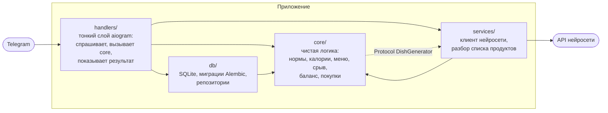
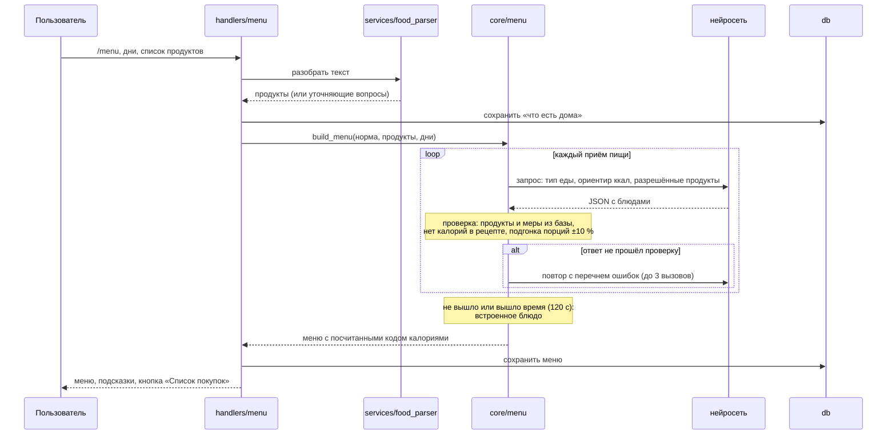

# Архитектура

## Слои

**Правило зависимостей.** `core/` не знает ни про Telegram, ни про базу данных, ни про сеть: он импортирует только стандартную библиотеку и настройки. Все остальные слои зависят от него, а не наоборот. Это проверяет тест `tests/unit/core/test_architecture.py`: он разбирает импорты каждого файла в `core/` и падает, если там появился `aiogram`, `sqlalchemy`, `openai` и подобное.

Единственная связь «наружу» это протокол `DishGenerator` в `core/menu.py` (метод `generate`). Его реализуют `OpenAICompatibleLLM` (настоящий клиент) и `FakeLLM` (заглушка для тестов и работы без ключа) из `services/llm.py`.

## Модули

| Слой | Модуль | Отвечает за |
|---|---|---|
| core | `norms.py` | норма калорий и БЖУ (Миффлин-Сан Жеор), нижняя граница, безопасный темп смены веса |
| core | `measures.py` | каталог продуктов и мер, перевод «мера → граммы → КБЖУ» |
| core | `nutrition.py` | КБЖУ блюда, приёма пищи и дня; перевод готового веса в сырой |
| core | `menu.py` | проверка ответа нейросети, подгонка порций, повторы, запасные блюда, сборка дня и меню |
| core | `slip.py` | мягкий пересчёт после отклонения от плана |
| core | `balance.py` | подсказки «чего не хватает»: белок, овощи и фрукты, клетчатка |
| core | `shopping.py` | список покупок с переводом готового в сырое |
| services | `llm.py` | клиент любого OpenAI-совместимого API, заглушка, фабрика `build_llm` |
| services | `food_parser.py` | свободный текст → продукты (формы слов, опечатки, простые количества) |
| db | `models.py`, `repositories/` | таблицы и доступ к ним; наружу отдаются типы `core`, а не ORM-объекты |
| db | `seed.py` | загрузка и проверка CSV с продуктами |
| handlers | `onboarding`, `profile`, `menu`, `shopping`, `slip`, `goal` | по одному диалогу на модуль |
| handlers | `guard.py` | защита платной нейросети от спама кнопками |
| handlers | `render.py`, `texts.py` | превращение результатов в русские сообщения; все тексты в одном месте |

## Поток данных: меню

Калории и БЖУ в этом потоке считает только `core/nutrition.py` по базе продуктов. Из ответа нейросети берутся названия, список ингредиентов (с номерами продуктов и мер) и текст рецепта.

## Поток данных: пересчёт после «срыва»

1. `/slip`: человек пишет, что съел сверх меню (список продуктов), или выбирает примерный размер.
2. Список переводится в калории по базе (не нейросетью) и подтверждается человеком.
3. `core/slip.py` решает: отклонение до 5 % нормы игнорируется, меньше плана не «добирается», остальное растягивается на ближайшие 3 дня, не больше 10 % нормы в день и никогда не ниже нижней границы калорий. Что не удалось компенсировать, остаётся как есть.
4. Поправки сохраняются у пользователя (`users.pending_adjust`) и применяются к **следующему** меню через `apply_adjustment`. После применения очищаются.
5. Ответ человеку берётся из `texts.SLIP_TEXTS` (спокойный тон, без упрёков: за этим следит тест).

## База данных

SQLite через SQLAlchemy 2 (async) и Alembic. Миграции применяются при старте бота.

| Таблица | Содержимое |
|---|---|
| `foods`, `food_aliases`, `measures` | справочник продуктов, синонимы, бытовые меры (наполняется из CSV, повторный запуск безопасен) |
| `users` | `telegram_id` и анкета (пол, возраст, рост, вес, активность, цель), отложенные поправки |
| `user_foods` | продукты «что есть дома» |
| `user_menus` | последнее меню пользователя одним JSON |
| `user_events` | события использования для беты: `telegram_id`, имя события, время (без текстов) |

Имя, телефон и тексты сообщений не хранятся. Команда `/delete_me` удаляет пользователя, остальное уходит каскадом. Отчёт по событиям: `uv run python scripts/beta_report.py`.

## Надёжность и защита

- **Нейросеть недоступна или отвечает мусором:** до 2 повторов с обратной связью, затем встроенное блюдо. Бот остаётся полностью работоспособным и без ключа.
- **Общий лимит времени на меню (120 с):** зависший вызов отменяется, оставшиеся приёмы пищи берутся из встроенных блюд.
- **Защита от спама:** одно построение меню на пользователя одновременно и пауза 30 с после него.
- **Сообщения без разметки:** бот не задаёт `parse_mode`, поэтому текст нейросети не может внедрить HTML или ссылки.
- **Ошибки:** общий обработчик логирует только тип исключения и показывает человеку дружелюбное сообщение.
- **Устаревшие кнопки:** получают короткую подсказку вместо бесконечной загрузки.

## Тесты

Тесты зеркалят структуру кода: `tests/unit/core/`, `tests/unit/services/`, `tests/unit/handlers/`, `tests/integration/` (база и бот целиком с подменённым Telegram). Сквозные тесты прогоняют настоящий диспетчер, база на реальных данных, нейросеть заменена `FakeLLM`. Порог покрытия 80 % на весь код и 90 % на `core/` (проверяется в CI).
